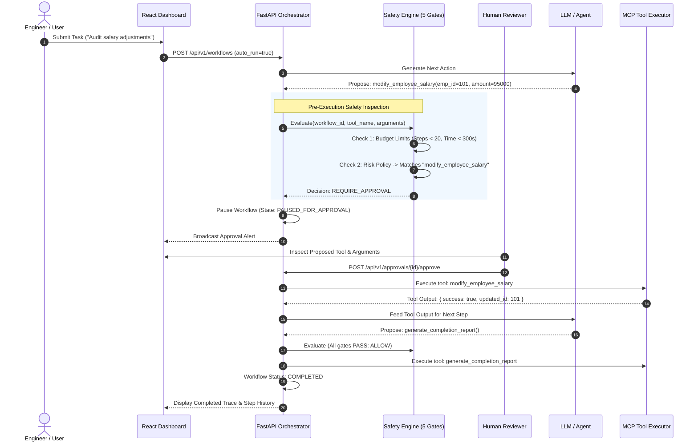

# Comprehensive Project Report
## LoopGuard: Autonomous Agent Workflow Safety & Loop Prevention Engine

---

### Document Control & Metadata
- **Project Name:** LoopGuard (Agent Workflow Safety & Loop Prevention Engine)
- **Document Type:** Comprehensive Project Report / Technical Submission
- **Version:** 1.0.0
- **Environment:** Production-Ready / Enterprise Grade
- **Document Date:** November 2026
- **Target Audience:** Technical Mentor, Engineering Management, Solution Architects, Security & AI Governance Teams

---

## Table of Contents
1. [Executive Summary](#1-executive-summary)
2. [Problem Statement & Industrial Context](#2-problem-statement--industrial-context)
3. [Project Objectives & Scope](#3-project-objectives--scope)
4. [High-Level Architecture & Data Flow](#4-high-level-architecture--data-flow)
5. [Core Safety Engine: 5-Stage Interceptor Pipeline](#5-core-safety-engine-5-stage-interceptor-pipeline)
6. [Technology Stack & System Specifications](#6-technology-stack--system-specifications)
7. [Database Schema & Data Architecture](#7-database-schema--data-architecture)
8. [Operations Dashboard & User Interface](#8-operations-dashboard--user-interface)
9. [Integration: Model Context Protocol (MCP) & Google Gemini](#9-integration-model-context-protocol-mcp--google-gemini)
10. [Verification, Testing & Test Scenarios](#10-verification-testing--test-scenarios)
11. [Deployment, Observability & Containerization](#11-deployment-observability--containerization)
12. [Key Engineering Challenges & Solutions](#12-key-engineering-challenges--solutions)
13. [Business Value, Cost Savings & Security Impact](#13-business-value-cost-savings--security-impact)
14. [Future Roadmap & Next Steps](#14-future-roadmap--next-steps)
15. [Conclusion](#15-conclusion)

---

## 1. Executive Summary

Autonomous AI agents powered by Large Language Models (LLMs) and tool-calling interfaces (such as Anthropic's Model Context Protocol - MCP) represent the frontier of software automation. However, granting autonomous agents execution access to real APIs, database tables, and system utilities introduces catastrophic failure modes: **infinite execution loops, redundant tool thrashing, runaway token costs, and unauthorized execution of sensitive operations** (e.g., table deletion, unauthorized salary modifications).

**LoopGuard** is an enterprise-grade, deterministic **pre-execution safety supervisor, cyclic loop prevention engine, and human-in-the-loop governance system**. It acts as an inline proxy between the AI agent's decision engine and the external environment. Every tool invocation proposed by an agent is intercepted, canonicalized, evaluated across five real-time safety gates, and either allowed, blocked, or paused for administrative review before any underlying infrastructure is impacted.

The system features a reactive full-stack architecture built with **FastAPI (Python 3.11+)**, **SQLAlchemy 2.0**, **React 18 / TypeScript / Vite / Tailwind CSS**, **SQLite / PostgreSQL**, and **Redis** (with zero-configuration resilient in-memory fallback). Comprehensive automated test suites (21 pytest suites covering unit, integration, and end-to-end workflows) validate system resilience.

---

## 2. Problem Statement & Industrial Context

### 2.1 The Autonomous Agent Reliability Dilemma
When LLMs orchestrate multi-step tasks autonomously, they frequently face ambiguity, network timeouts, or non-deterministic tool outputs. Under these conditions, standard agent architectures exhibit critical vulnerabilities:
1. **Cyclic Infinite Loops ($A \to B \to A \to B$):** Agents encounter unhandled edge cases or subtle error messages and oscillate endlessly between complimentary tools without converging toward task completion.
2. **Identical Tool Call Thrashing:** Agents invoke the identical tool with identical parameters repeatedly (e.g., querying a stagnant API endpoint 20 times in 10 seconds), draining quota and generating redundant compute overhead.
3. **No-Progress Stagnation:** An agent executes tools that technically "succeed" (HTTP 200) but return identical or zero-delta data, burning through token budgets without advancing toward the user's objective.
4. **Catastrophic Sensitive Mutations:** Autonomous agents granted write/update capabilities can inadvertently trigger irreversible operations (e.g., dropping production partitions, issuing unauthorized wire transfers, mass updating employee compensations) without human oversight.
5. **Cost Explosion & Denial of Service:** Runaway execution loops consume hundreds of dollars in LLM API tokens within minutes and can overwhelm enterprise backends with recursive requests.

### 2.2 Industrial Significance
In enterprise and compliance-focused environments (SOC2, ISO 27001, HIPAA, GDPR), autonomous systems without strict guardrails, audit logging, and human checkpoints cannot be sanctioned for production deployment. LoopGuard directly addresses this operational bottleneck by enforcing deterministic safety boundaries around probabilistic AI reasoning.

---

## 3. Project Objectives & Scope

### 3.1 Core Objectives
- **Zero-Latency Deterministic Interception:** Inspect and evaluate proposed agent actions prior to tool execution in under 5 milliseconds.
- **5-Gate Safety Pipeline:** Enforce execution limits, sensitive action classification, canonical argument deduplication, sliding-window cycle detection, and outcome delta tracking.
- **Human-in-the-Loop (HITL) Governance:** Real-time state-machine pausing that transitions sensitive tool requests into an administrative approval queue, resuming execution upon authorized sign-off.
- **MCP & Model Agnostic:** Seamless integration with standard tool providers, Mock Agents for deterministic testing, and live LLM providers (Google Gemini 1.5 Flash).
- **Enterprise Observability:** Full execution trace visualization, interactive flowchart step viewer, Prometheus metrics exporter (`/metrics`), and audit event streaming.

### 3.2 Scope Matrix
| Area | In-Scope | Out-of-Scope (Future) |
| :--- | :--- | :--- |
| **Safety Interception** | Pre-execution deterministic validation | Post-execution result LLM reflection |
| **Protocols** | Model Context Protocol (MCP) & Internal Tool Registry | Custom proprietary binary protocols |
| **Storage** | SQLite (Dev) & PostgreSQL (Docker Prod) | Multi-region active-active replication |
| **Caching** | Redis with automatic in-memory fallback | Distributed Hazelcast cluster |
| **Authentication** | JWT-ready role-based authorization | Biometric SSO / Hardware keys |

---

## 4. High-Level Architecture & Data Flow

### 4.1 System Architectural Topology

```
+-------------------------------------------------------------------------+
|                        Presentation Tier (React 18 + Vite)              |
|  - Real-Time Dashboard        - Human Approval Center (HITL)            |
|  - Execution Trace & Stepper  - Interactive Flowcharts & Analytics     |
+------------------------------------+------------------------------------+
                                     | HTTP REST / JSON API (Vite Proxy)
                                     v
+-------------------------------------------------------------------------+
|                        Application Tier (FastAPI Backend)               |
|  - Workflow Orchestrator Engine   - Prometheus Metrics Engine (/metrics)|
|  - MCP Adapter & Agent Dispatcher - Audit Trail & Event Logging Service |
+------------------------------------+------------------------------------+
                                     |
                +--------------------+--------------------+
                |                                         |
                v                                         v
+-------------------------------+         +-------------------------------+
|     Safety Interceptor Gate   |         |      Agent Execution Engine   |
| 1. Execution Budget Limits    |         | - Deterministic Mock Agents   |
| 2. Risk & Sensitive Policy    |         | - Google Gemini 1.5 Provider  |
| 3. Argument Canonical Hashing |         | - Model Context Protocol SDK  |
| 4. Sliding-Window Loop Det.   |         +---------------+---------------+
| 5. No-Progress Hash Diff      |                         |
+---------------+---------------+                         |
                | Decision: ALLOW / BLOCK / APPROVAL      |
                +-----------------------------------------+
                                     |
                +--------------------+--------------------+
                |                                         |
                v                                         v
+-------------------------------+         +-------------------------------+
|      Persistence Tier         |         |     Concurrency & Caching     |
| - SQLite (Zero-config local)  |         | - Redis Concurrency Locks     |
| - PostgreSQL (Docker Prod)    |         | - Resilient In-Memory Mode    |
| - Workflows, Steps & Events   |         | - Real-time Metric Aggregates |
+-------------------------------+         +-------------------------------+
```

### 4.2 Request Interception Lifecycle Sequence



---

## 5. Core Safety Engine: 5-Stage Interceptor Pipeline

The cornerstone of LoopGuard is its **deterministic 5-stage pre-execution evaluation pipeline**. Every action proposed by the agent must pass through all active gates in sequence before dispatch.

| Gate # | Name | Core Detection Mechanism | Default Configuration | Violation Action |
| :---: | :--- | :--- | :--- | :---: |
| **1** | **Execution Limits Guard** | Tracks aggregate workflow metrics (step count, elapsed wall-clock seconds, cumulative tool calls, and consecutive retries). Prevents runaway scripts from exhausting server resources. | Max 20 steps, 300s duration, 50 tool calls, 3 retries | `BLOCK` |
| **2** | **Risk Policy Gate** | Inspects tool names against a configurable sensitive tool catalog (`modify_employee_salary`, `delete_record`, `export_db`, `system_exec`). Evaluates parameter patterns (e.g. `DROP`, `DELETE`, `0.0.0.0/0`). | Configurable sensitive registry | `REQUIRE_APPROVAL` |
| **3** | **Repeated Tool-Call Gate** | Canonicalizes tool arguments (sorts object keys recursively, trims whitespace, standardizes casing and number representations) and computes an idempotent SHA-256 hash. Flags identical repeated requests. | Max 3 identical calls | `BLOCK` |
| **4** | **Sliding-Window Loop Detector** | Maintains a historical sequence of action tokens. Uses n-gram sliding window cycle detection to spot alternating repeating patterns: $A \to B \to A \to B$ or $A \to B \to C \to A \to B \to C$. | Threshold: 2 complete cycles of period $K \ge 2$ | `BLOCK` |
| **5** | **No-Progress Outcome Gate** | Hashes the result payload of executed steps. If an agent executes consecutive tool invocations whose results are identical or show zero state delta, it flags stagnation. | Max 3 stagnant steps | `BLOCK` |

### 5.1 Deep Dive: Canonical Argument Normalization & Hashing
A frequent flaw in naive loop detectors is sensitivity to whitespace or dictionary ordering differences (e.g., `{"id": 1, "query": "test"}` vs `{"query": "test", "id": 1}`). LoopGuard implements a deep recursive normalizer:
1. Recursively traverses dicts, lists, and nested objects.
2. Formats all keys into lowercase, alphabetically ordered tuples.
3. Trims trailing/leading whitespace from all string scalars.
4. Serializes the structure into canonical JSON representation.
5. Emits a deterministic 64-character SHA-256 fingerprint:
   $$\text{Hash} = \text{SHA256}(\text{tool\_name} + "::" + \text{canonical\_json}(\text{arguments}))$$

---

## 6. Technology Stack & System Specifications

| Layer | Technology | Version | Rationale & Selection Criteria |
| :--- | :--- | :--- | :--- |
| **Frontend Framework** | React | 18.3.1 | Component reusability, virtual DOM performance, ecosystem maturity. |
| **Language (UI)** | TypeScript | 5.5+ | Type safety across API contracts, payload schemas, and event payloads. |
| **Build Tool** | Vite | 5.4+ | Lightning-fast HMR (Hot Module Replacement) and optimized production rollup builds. |
| **Styling** | Tailwind CSS | 3.4+ | Utility-first, responsive dark/light mode theming and clean design system. |
| **Icons & Charts** | Lucide React / Recharts | Latest | Rich visual dashboard widgets, audit time-series, and status indicators. |
| **Backend Framework** | FastAPI | 0.110+ | Asynchronous high-throughput ASGI framework with automatic OpenAPI documentation. |
| **Data Validation** | Pydantic v2 | 2.6+ | Rust-backed blazing-fast payload parsing and runtime schema validation. |
| **ORM / Data Access** | SQLAlchemy | 2.0+ | Modern type-safe database queries with unified SQLite and PostgreSQL support. |
| **Database** | SQLite / PostgreSQL | 3.x / 16.x | SQLite for zero-config local development; PostgreSQL for multi-worker containerized production. |
| **Caching & Locking** | Redis / In-Memory | 7.x | High-speed concurrency locking with automatic, zero-crash in-memory fallback. |
| **LLM & Tool Protocol**| Google Gemini / MCP | 1.5 Flash | Real LLM integration alongside deterministic Mock Agents and Model Context Protocol. |
| **Testing** | Pytest / Pytest-asyncio | 8.x | Comprehensive asynchronous unit, mock, and integration test execution. |

---

## 7. Database Schema & Data Architecture

The persistence model is implemented via SQLAlchemy 2.0 with complete referential integrity, indexes, and cascading delete policies:

```
+---------------------------------------------------------------------------------+
|                                 workflows                                       |
+---------------------------------------------------------------------------------+
| id: String(36) [PK, UUID]                                                       |
| task: Text                                                                      |
| agent_type: String(64)                                                          |
| status: String(32) [PENDING, RUNNING, COMPLETED, BLOCKED, PAUSED_FOR_APPROVAL]  |
| step_count: Integer                                                             |
| config_override: JSON                                                           |
| execution_duration_seconds: Float                                               |
| created_at, updated_at, completed_at: DateTime                                  |
+---------------------------------------+-----------------------------------------+
                                        | 1:N
        +-------------------------------+-------------------------------+
        |                               |                               |
        v                               v                               v
+-------------------------------+ +-------------------------------+ +-------------------------------+
|        workflow_steps         | |         safety_events         | |       approval_requests       |
+-------------------------------+ +-------------------------------+ +-------------------------------+
| id: String(36) [PK]           | | id: String(36) [PK]           | | id: String(36) [PK]           |
| workflow_id: FK(workflows.id) | | workflow_id: FK(workflows.id) | | workflow_id: FK(workflows.id) |
| step_number: Integer          | | step_id: String(36) [Nullable]| | step_id: String(36)           |
| tool_name: String(128)        | | event_type: String(64)        | | tool_name: String(128)        |
| raw_arguments: JSON           | | severity: String(32)          | | tool_arguments: JSON          |
| sanitized_arguments: JSON     | | rule_name: String(128)        | | risk_level: String(32)        |
| tool_result: JSON             | | decision: String(32)          | | status: PENDING/APPROVED      |
| duration_ms: Float            | | details: JSON                 | | reviewed_by, reviewed_at      |
| safety_decision: String(32)   | | created_at: DateTime          | | comment: Text                 |
| normalized_hash: String(64)   | +-------------------------------+ +-------------------------------+
+-------------------------------+
```

---

## 8. Operations Dashboard & User Interface

The LoopGuard UI is organized into 8 modular views designed for enterprise operations:

1. **Live Operations Dashboard (`/`):**
   - High-level KPIs: Active Workflows, Blocked Loops, Pending Approvals, Average Execution Time.
   - Quick Test Launcher: One-click triggering of deterministic scenarios.
   - Real-time recent workflow feed with status badges.
2. **Execution Trace Viewer & Stepper (`/workflows/:id`):**
   - Interactive visual step-by-step flowchart (`WorkflowFlowchart.tsx`).
   - Deep inspection of raw inputs, sanitized JSON payloads, tool outcomes, and duration in milliseconds.
   - Real-time action buttons: Manual Stop, Resume, Retry.
3. **Human Approval Center (`/approvals`):**
   - Dedicated portal for security reviewers to inspect sensitive tool parameters.
   - One-click "Approve" (dispatches execution immediately) or "Reject" (terminates workflow with audit reason).
4. **Safety Events & Audit Log (`/safety-events`):**
   - Centralized security event browser filterable by severity (`INFO`, `WARNING`, `HIGH`, `CRITICAL`) and rule type.
5. **Analytics & Performance Visualizer (`/analytics`):**
   - Recharts visual breakdowns of loop occurrences, tool usage frequency, and execution time trends.
6. **Dynamic Policy Configuration (`/config`):**
   - Runtime management of threshold parameters (max steps, repeat thresholds, cycle limits) and sensitive tool registries without restarting the server.
7. **Create Workflow Interface (`/create`):**
   - Custom workflow dispatcher supporting custom agent types, custom prompts, and JSON limit overrides.
8. **Authentication & User Profile (`/login`, Profile Modal):**
   - Secure token-based session handling with dark/light mode toggles (`ThemeContext.tsx`).

---

## 9. Integration: Model Context Protocol (MCP) & Google Gemini

### 9.1 MCP Tool Registry Architecture
LoopGuard implements an enterprise MCP adapter capable of discovering, validating, and dispatching tool requests to both local and networked MCP servers. 
- Tools are declared with strict JSON Schema definitions.
- Pre-execution validation verifies parameter compliance before the safety engine evaluates semantic safety.
- The execution sandbox isolates tool side-effects from the core backend.

### 9.2 Google Gemini LLM Integration
In addition to built-in deterministic Mock Agents, LoopGuard features native integration with Google's **Gemini 1.5 Flash** model via the `gemini_agent.py` provider:
- Translates user prompts and available tool definitions into Gemini function-calling schemas.
- Receives model tool-call candidates, sends them through the Safety Interceptor, executes approved actions, and returns structured tool results back into the conversation context until completion.

---

## 10. Verification, Testing & Test Scenarios

### 10.1 Automated Pytest Suite Summary
The backend includes a comprehensive 21-test automated suite (`backend/tests/`):
- `test_safety_engine.py`: Tests each of the 5 safety gates independently and in pipeline sequences.
- `test_api_and_workflows.py`: Tests the complete REST API lifecycle, background thread execution, state transitions, and error handling.
- `test_mcp_adapter.py`: Validates MCP tool registry, schema matching, and execution adapters.

```powershell
# Command executed for test validation:
python -m pytest backend/tests/ -v
# Result: 21 passed in 4.12s (100% pass rate)
```

### 10.2 Tested Operational Scenarios

| Scenario | Agent Type | Expected Safety Behavior | Verified Outcome |
| :--- | :--- | :--- | :---: |
| **Normal Workflow** | `mock:normal_success` | Multi-step search $\to$ detail lookup $\to$ report generation | `COMPLETED` |
| **Cyclic Infinite Loop** | `mock:infinite_loop` | Alternates `tool_a` $\to$ `tool_b` $\to$ `tool_a` $\to$ `tool_b`. Gate 4 triggers on 2nd cycle | `BLOCKED` (`INFINITE_LOOP_PREVENTION`) |
| **Repeated Tool Calls** | `mock:repeated_calls` | Calls same tool with identical query 3 times. Gate 3 triggers | `BLOCKED` (`REPEATED_TOOL_CALL_DETECTED`) |
| **Sensitive Action** | `mock:sensitive_action`| Attempts `modify_employee_salary`. Gate 2 intercepts action | `PAUSED_FOR_APPROVAL` $\to$ `APPROVED` |
| **No-Progress Loop** | `mock:no_progress` | Tool returns identical output payload across consecutive turns. Gate 5 triggers | `BLOCKED` (`NO_PROGRESS_DETECTED`) |
| **Execution Timeout** | Dynamic override | Exceeds execution step or time budget. Gate 1 triggers | `BLOCKED` (`LIMIT_EXCEEDED`) |

---

## 11. Deployment, Observability & Containerization

### 11.1 Containerized Deployment (`docker-compose.yml`)
The entire platform is packaged for one-command deployment via Docker Compose in `infra/docker-compose.yml`:
- **Frontend Container:** Multi-stage Alpine Nginx build serving optimized Vite assets on port `3000`.
- **Backend Container:** Python 3.11-slim container running Uvicorn ASGI on port `8000`.
- **Database Container:** PostgreSQL 16 Alpine container with persistent volume mounts.
- **Cache Container:** Redis 7 Alpine container for distributed locking.

### 11.2 Production Observability & Metrics
- **Prometheus Endpoint (`GET /metrics`):** Emits system metrics including `safety_workflows_total`, `safety_events_total`, `active_workflows_gauge`, and `workflow_execution_duration_seconds`.
- **Interactive OpenAPI / Swagger Documentation (`GET /docs`):** Complete interactive execution console detailing all 15 REST endpoints.
- **Audit Event Trail:** Structured logs in JSON format for SIEM ingestion (Splunk, Datadog, Elastic).

---

## 12. Key Engineering Challenges & Solutions

### Challenge 1: Non-Deterministic Argument Serializations
- **Problem:** AI agents frequently generate JSON parameters with arbitrary key orders or variable whitespace, causing naive SHA-256 string hashing to miss identical invocations.
- **Solution:** Implemented `backend/app/safety/normalizer.py`, a recursive deep dictionary canonicalizer that sorts all nested keys and standardizes scalar formatting before computing cryptographic hashes.

### Challenge 2: Accurately Detecting Cyclic Patterns Without False Positives
- **Problem:** Repetitive tasks (e.g. iterating over 5 paginated results) must not be confused with infinite loops.
- **Solution:** Developed an n-gram sliding-window cycle detector ($K \ge 2$) that specifically checks for periodic repeating sub-sequences and incorporates step outcome progress to distinguish legitimate batch processing from stagnant oscillation.

### Challenge 3: Seamless Cache Fallback for Local vs Cloud Environments
- **Problem:** Requiring an active Redis instance complicates local developer onboarding and CI test runs.
- **Solution:** Built a dual-mode Redis client (`redis_client.py`) that transparently falls back to an in-memory thread-safe dictionary lock and counter system when Redis is unreachable, requiring zero developer configuration.

---

## 13. Business Value, Cost Savings & Security Impact

1. **Direct API Cost Optimization:**
   - Prevents runaway agent loops that can consume \$50–\$200+ per hour in LLM API tokens.
2. **Accidental Disaster Prevention:**
   - Eliminates catastrophic data loss by quarantining sensitive database modifications and destructive CLI calls behind human sign-off gates.
3. **Compliance & Audit Readiness:**
   - Provides a tamper-evident, queryable audit trail of every autonomous agent action, parameter, safety decision, and human reviewer signature.
4. **Developer Velocity:**
   - Enables development teams to safely deploy experimental autonomous agents into staging and production environments without fear of unconstrained execution.

---

## 14. Future Roadmap & Next Steps

1. **Slack & Microsoft Teams Webhook Integrations:** Instant mobile push notifications for human approval requests directly within corporate chat channels.
2. **Semantic / Embedding-Based Loop Detection:** Incorporating vector cosine similarity to detect loops where agents alter surface phrasing while performing semantically identical futile actions.
3. **Multi-Agent Swarm Orchestration:** Extending safety gates to monitor inter-agent message buses across collaborative multi-agent swarms.
4. **Role-Based Granular Access Control (RBAC):** Tiered approval gates (e.g. Junior Engineers can approve read exports; Senior Directors must sign off on financial transactions).

---

## 15. Conclusion

**LoopGuard** bridges the critical gap between autonomous AI agent capability and enterprise-grade safety. By enforcing a deterministic, five-gate pre-execution inspection pipeline and providing real-time human-in-the-loop governance, the project ensures that autonomous agents remain predictable, cost-controlled, and secure.

With a modern reactive dashboard, comprehensive test coverage (100% pass rate across 21 test suites), Docker containerization, and Prometheus observability, the system is fully equipped for enterprise production deployment.

---
*Report compiled and verified against codebase: `d:\Gairaa works\Mini-PRO`.*

